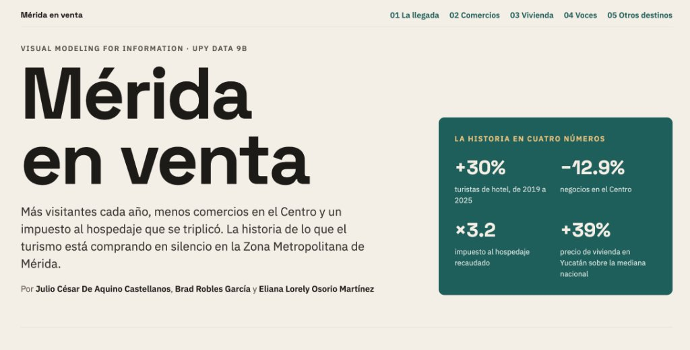

# Mérida for Sale — Limpieza de Datos (Secciones 1 a 9)

Extracción, limpieza y estandarización de fuentes para el dashboard grupal sobre turistificación y gentrificación en Mérida, Yucatán (véase [`merida_for_sale_sources.md`](merida_for_sale_sources.md)).

## Secciones incluidas

- **[`1-INEGI-DENUE/`](1-INEGI-DENUE/README.md)**
  - **INEGI DENUE 2019 vs. 2025:** hospedaje (721), restaurantes y bares (722), cafeterías (722515) y abarrotes (461110) en Mérida y dentro del polígono del Centro Histórico; 16,936 establecimientos clave y resumen por 575 AGEB.
  - **Censo 2010 y 2020:** población y vivienda de Mérida y Yucatán (cifras publicadas; AGEB pendiente).
- **[`2-Datos-Gob-Mx/`](2-Datos-Gob-Mx/README.md)**
  - **DataTur:** llegadas mensuales a Mérida por categoría hotelera, nacionales vs. extranjeros (enero 2015 – septiembre 2026).
  - **ASUR:** pasajeros de Mérida, Cancún y Oaxaca con % internacional, variación anual e índice 2019 = 100 (2000–2026).
- **[`3-SIEGY-Yucatan/`](3-SIEGY-Yucatan/README.md)**
  - **Sefotur:** ocupación hotelera de Mérida, turistas del estado por origen e ingreso hotelero estatal; validado contra DataTur y ASUR (53 de 53 cifras coinciden).
  - **SHF:** precio promedio y percentiles de vivienda por estado (3T2025 – 2T2026).
  - **ENOE:** empleo, ingreso por salarios mínimos y pobreza laboral en Yucatán (2T2025 vs. 2T2026).
- **[`4-GeoPortal-Merida/`](4-GeoPortal-Merida/README.md)**
  - **GeoPortal de Mérida:** colonias (500), Zona de Monumentos Históricos / Centro Histórico (1) y Zonas Patrimoniales Culturales Municipales (73) en `EPSG:4326`.
  - **OpenStreetMap (Overpass API):** 404 puntos de hospedaje y cafeterías en Mérida.
  - **INEGI Marco Geoestadístico:** 541 AGEBs urbanas y límite municipal de Mérida (`EPSG:4326`).
- **[`5-Government-Data-Request/`](5-Government-Data-Request/README.md)**
  - **AAFY (Folio `1191207426000093`):** recaudación mensual del Impuesto por Servicios de Hospedaje (enero 2015 – septiembre 2026).
  - **Ayuntamiento de Mérida (Folio `1190579126000609`):** 1,254 licencias de funcionamiento emitidas en el Centro (2015–2026).
- **[`6-Web-Scraping/`](6-Web-Scraping/README.md)**
  - **Prensa local (Diario de Yucatán, Por Esto!, La Jornada Maya):** 1,495 notas de 2018 a 2026 sobre rentas, desalojos, despojo, inmobiliarias y gentrificación, con temas, colonias del GeoPortal mencionadas y extracto de máximo 200 caracteres (el texto completo no va en git); 9,339 URL candidatas como universo.
  - **Wikipedia:** vistas mensuales (2016–2026) de Mérida, Oaxaca, San Miguel de Allende y Playa del Carmen en inglés y español, con índice 2019 = 100.
  - **YouTube Data API:** 349 videos de "moving to / living in / mudarse a Mérida" con vistas y likes, y conteos de palabras clave (rent, safe, cheap, gentrification…) en comentarios de los 150 más vistos, sin autores ni texto.
- **[`7-Self-Produced/`](7-Self-Produced/README.md)**
  - **GDELT:** grabador propio del GKG cada 15 minutos (corriendo, pero el GKG público casi no trae Mérida) y respaldo de la DOC API: 655 artículos sobre Mérida (31 ago – 23 nov 2026) clasificados por voz local / nacional / internacional, con tono semanal y temas.
  - **Trabajo de campo (letreros e "índice del americano"):** plantillas y script de limpieza listos; pendiente de levantar.
- **[`8-LiDAR/`](8-LiDAR/README.md)**
  - **INEGI MDE de alta resolución (5 m, más 1.5 m para validar):** altura por manzana (media, p90, máximo, % > 6 m) para 2,389 manzanas del Centro + 500 m; 831 de 871 manzanas de AR 1 cruzan por `clave_manzana`. Para estas cartas el modelo es fotogramétrico de satélite (2015), no LiDAR aerotransportado.
- **[`9-Augmented-Reality/`](9-Augmented-Reality/README.md)**
  - **Escena AR 1 (INEGI DENUE 2019 vs. 2025):** 14,207 registros en Mérida Centro y resumen por 871 manzanas.
  - **Escena AR 2 (DataTur):** llegadas mensuales y anuales de turistas nacionales vs. extranjeros en Mérida (2015–2026).
  - **Escena AR 3 (ASUR):** tráfico mensual y crecimiento anual de pasajeros en Mérida (`MID`), Cancún (`CUN`) y Oaxaca (`OAX`) (2000–2026).

## Booklet final (D3.js + AR)

- **[`booklet/`](booklet/README.md)**: entrega final en español con gráficas en **D3.js v7**, prólogo («La historia en cuatro números»), 5 capítulos con títulos-hallazgo, imagen del 3D del Centro con código QR y visor de Realidad Aumentada (`<model-viewer>`) en [`booklet/ar/`](booklet/ar/index.html).



## Entorno reproducible

```bash
python3 -m venv .venv
source .venv/bin/activate
pip install -r requirements.txt
```

En Windows (PowerShell): `py -3 -m venv .venv`, `.venv\Scripts\Activate.ps1` y el mismo `pip install`. `rasterio` y `shapely` se instalan con wheels de pip, sin GDAL aparte (probado con Python 3.13).
